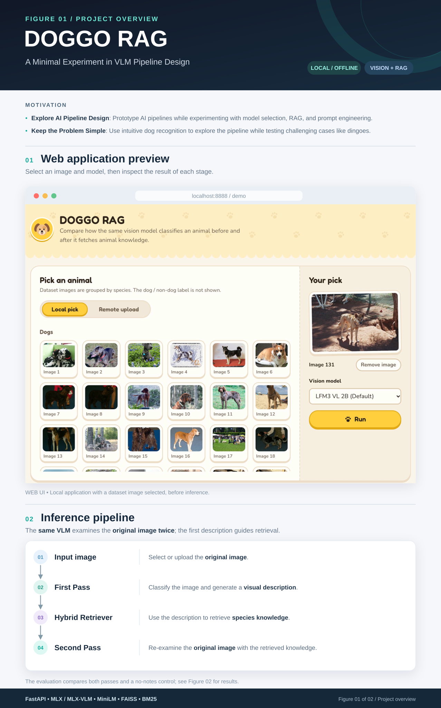

# DOGGO RAG

> Does a RAG-assisted Second Pass make a local Vision Model better at telling
> domestic dogs from look-alike animals (wolf, fox, coyote, dingo, …)?

Each image gets `is_dog`: `true` (domestic dog), `false` (any other animal,
**including dingoes**) or `null` (not enough evidence). Runs fully offline on
Apple Silicon after model download. Full requirements: `docs/agents/spec.md`.



## Results


The evaluation uses even-numbered images for development and odd-numbered
images for testing within the same 200-image dataset; there is no separate
held-out dataset. Failed inference outputs are recorded, not scored.

Full report: `results/eval.html`. Per-image results are stored in the JSONL files;
`results/paired-summary.json` and `eval.html` are generated by `make eval`.
`results/control/` contains the no-notes control results generated by
`make control`.

## Quickstart

```bash
uv sync
make download                 # only step that uses the network
make eval                     # 3 models x 200 images, verify, write report
make eval FRESH=1 LIMIT=5     # quick smoke test
make fast-eval                # all models, 100 non-dogs + 10 sampled dogs -> results/fast/eval.html
make fast-eval MODEL=lfm3-vl-2b DOGS=20   # one model, 20 dogs (see Makefile header for all parameters)
make control                  # the scored Second Passes again without the notes -> results/control/
export DOGGO_API_KEY=$(python -c 'import secrets; print(secrets.token_urlsafe(32))')
make web                      # web app at http://127.0.0.1:8888 (asks for the key)
```

`make eval` resumes after interruption and refuses to mix runs if prompts,
knowledge or settings changed (then use `FRESH=1`).

Run metadata (`results/<model>/*.metadata.json`) records the prompts, knowledge
and inference-code hashes, retrieval and decoding settings, the Hugging Face
snapshot commit of the vision and embedding models, the Python, OS and package
versions, and a dataset version that hashes the manifest and every image.
Any change to these stops a resume.

If `doggo-dataset/images/` is missing: `python scripts/build_doggo_dataset.py`.

## Self-test loop

Try prompt, knowledge or retrieval changes with the lab, not with `make eval`:

```bash
make lab NAME=my-change                # real pipeline on the dev split (even image numbers)
make lab NAME=my-change SPLIT=test     # confirm a finished change on the odd numbers
python scripts/rag-lab.py lfm3 --split test --score results/lfm3-vl-2b/paired-....jsonl
```

It prints both pass accuracies, the fixed and broken images, failures, and how
often the image's own species was retrieved. Model outputs are cached in
`results/lab/cache/`, so a Second Pass change reruns only the Second Pass.
Details: `spec.md` §13.

## Single image

```bash
python -m app.cli ingest      # build the FAISS index (again after editing knowledge/)
python -m app.cli predict doggo-dataset/images/non_dog/fox/fox_001.jpg [--model qwen3-vl-2b]
```

```bash
curl -s localhost:8888/api/v1/pipeline/predict \
  -H "X-API-Key: $DOGGO_API_KEY" \
  -H 'content-type: application/json' \
  -d '{"image": "dataset:image-0001", "model_id": "lfm3-vl-2b"}'
```

## API

| Endpoint | Responsibility |
|---|---|
| `POST /api/v1/pipeline/predict` | Full two-pass pipeline (main endpoint) |
| `GET /api/v1/images` | Dataset images (IDs, names, species, previews; no binary label) |
| `GET /api/v1/images/dataset/{image_id}` | Dataset image preview |
| `POST /api/v1/images/uploads` | Validate (≤ 20 MiB, ≤ Pillow's ~89 MP limit) and temporarily store an uploaded image |
| `GET /api/v1/images/uploads/{upload_id}` | Uploaded image preview |
| `GET /api/v1/health` | Model and index readiness |

The prediction response carries both passes, the retrieval query and documents,
per-step statuses (`not_started`, `completed`, `failed`, `skipped`), stage
errors and timings. Outputs of completed steps are kept when a later step fails.
Requests run one at a time: a second request waits until the first finishes.
Retrieval fails with a "rebuild" error when the index no longer matches
`knowledge/` or the embedding settings.
Retrieval `score` and model `confidence` are not calibrated probabilities. The
HTTP endpoint accepts only dataset and upload references; use the CLI for local
paths.

Frontend dev with hot reload: `make serve` + `pnpm --dir frontend dev`.

Access control: `POST /pipeline/predict`, `GET /images` and `POST /images/uploads`
require the `X-API-Key` header to match the server's `DOGGO_API_KEY` (401 otherwise,
503 if the server has no key). Health and image previews stay open; uploads are
unguessable temporary IDs. Serve over HTTPS when not on localhost.

## Tests

```bash
uv run pytest           # fake models; does not prove MLX inference works
uv run pytest -m live   # real MLX: full pipeline once per model (needs make download + ingest)
```

Live result on 2026-11-03 (schema-constrained decoding): all three models pass.

## More

- `docs/agents/spec.md`: requirements, metrics, API, classification rules
- `knowledge/`: species facts. The dog/non-dog rule lives in `configs/prompts/policy.txt`.
